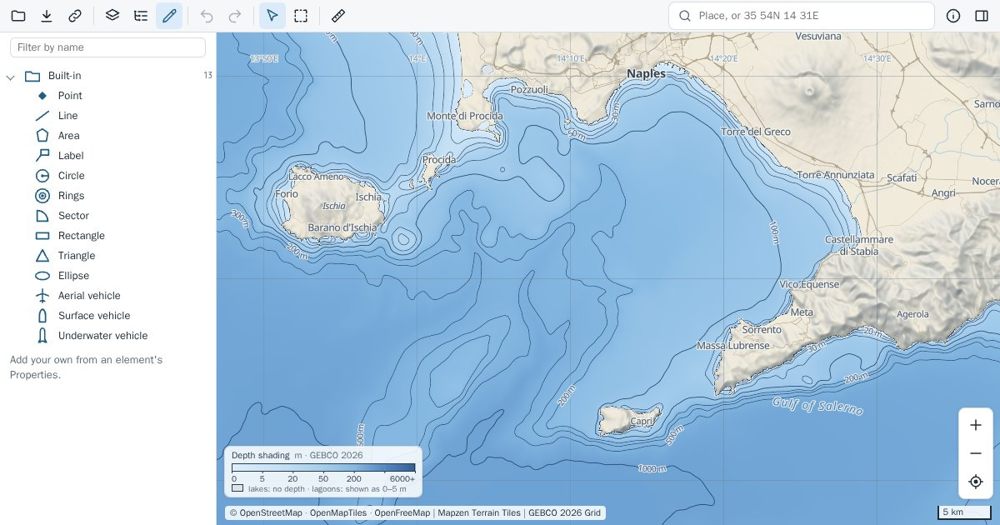

# Earth Plotter

**[earthplotter.org](https://earthplotter.org)**

A free map of the world's land and sea in your browser, from open data. It
draws the OpenStreetMap base map with relief and contours, depth shading and
isobaths, satellite imagery (and, in some countries, their national aerial
photos: the layer's ⋯ names them), seamarks, shipping density, ocean data from
Copernicus Marine and NASA's daily imagery. Measure and draw on it, export the
view as GIS data, and save areas to use without a connection.

**Not for navigation.** Positions, coastlines and depths come from open
datasets of varying accuracy. Depths are elevation models (GEBCO's, and EMODnet's in European seas), not
soundings.

## What you can do

Choose layers by task; each says where its data comes from, under what
licence, and how fine it is. Click the sea for its depth. Search a place or
type coordinates. Set one time for every layer that changes with time, and
one depth for the ocean variables. See what is normal for a month: wave
height, temperature, salinity and currents averaged over decades, and the
severe waves of European seas. Measure distances, bearings and areas along
the real curve of the Earth, in kilometres or nautical miles. Save the view
in the browser to open it without a connection: the base map, relief and
contours, depths and isobaths, and seamarks. Draw points,
shapes of real size, lines, areas and labels; keep them in groups; attach
lines to what they touch; place copies along a line and connect them to
roots. Read a line's elevation profile, at sea and on land. Export the view as a picture, as GIS data
that QGIS opens, or your drawing as GeoJSON. Install the page as an app on a
phone.

Everything runs in your browser, with no server of its own: the page fetches
each layer from its provider as you look at it. Every layer works without an
account or a key, but one optional choice: Esri's sharper satellite imagery,
which needs your own free ArcGIS key ([docs/esri-key.md](docs/esri-key.md)).

## Privacy

Drawings, saved areas and your location stay in your browser; tile requests
tell each provider which area you are looking at, and place names you type go
to the search provider. An Esri key, if you add one, stays in your browser and
goes only to Esri. The About dialog in the page says in full what leaves
your browser and what stays in it; each layer's ⋯ names its provider.

## Hosting a copy

The page is static: the `site/` folder can be served by any web server, with
no build and nothing to install. What a copy inherits, what it must provide
itself, and how to set it up: [docs/development.md](docs/development.md).

## More

- [docs/architecture.md](docs/architecture.md): how the code is shaped, and why.
- [docs/depths.md](docs/depths.md): where the depths and isobaths come from,
  and how far to trust them.
- [docs/drawing-ui.md](docs/drawing-ui.md) and
  [docs/drawing-format.md](docs/drawing-format.md): the drawing tools and
  their file.
- [docs/takeaways.md](docs/takeaways.md): what was learned the hard way.
- [ROADMAP.md](ROADMAP.md): what is open, what to research, what is not planned.

## Licence

The code is under GPL-3.0-or-later; see `LICENSE`. The libraries in
`site/vendor/` keep their own licences, copied beside them. Map data and
imagery stay under their providers' licences.
